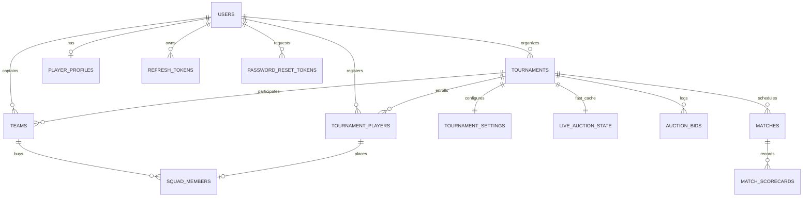
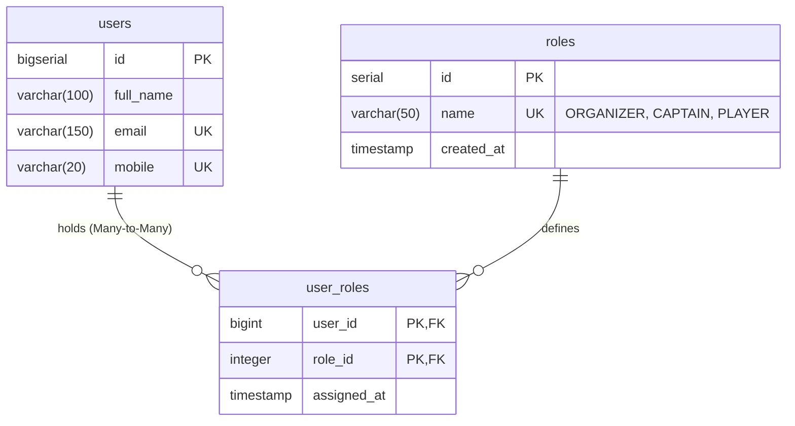

# CricAuction Master Project Context & Architectural Blueprint

> **Permanent Master Reference**: This document serves as the living architectural blueprint and single source of truth for **CricAuction-backbone**. It must be updated on every subsequent development and feature increment.

---

## 1. Project Mission & System Overview

**CricAuction** is a high-performance, mobile-first platform tailored for local and professional cricket tournament management, real-time live player auction rooms (the "hammer"), and ball-by-ball match scoring.

The system supports three distinct actor personas with strict role-based access control (RBAC):
1. **Tournament Organizer**: Creates tournaments, defines rules/purses, invites team captains, vets player registrations, controls the live auction hammer, schedules fixtures, and scores matches.
2. **Team Leader / Captain**: Accepts tournament invites, customizes team branding, monitors purse budget, curates target player wishlists, places real-time bids during auctions, and manages team squads.
3. **Cricket Player / Spectator**: Builds comprehensive cricket stats profile (CricHeroes sync), registers for tournaments, tracks auction bidding status in real-time, and follows live match scorecards.

---

## 2. Core Architectural Principles

### 2.1 The "Just PostgreSQL 16+" Strategy (Zero Redis Dependency)
To prevent split-brain cache desynchronization, double-spending bugs, and multi-service operational overhead, the architecture leverages modern **PostgreSQL 16+** engine capabilities to eliminate Redis completely:

```mermaid
flowchart TD
    Client["Clients: Mobile App / Web (Organizer, Captain, Player)"] -->|REST HTTPS| SpringBoot["Spring Boot 4.x / Java 23 Backend"]
    Client -->|WebSocket STOMP| SpringBoot

    subgraph Data Tier (Pure PostgreSQL 16+ & Object Store)
        SpringBoot -->|HikariCP / JPA / JdbcTemplate| Postgres[("PostgreSQL 16+ Engine")]
        SpringBoot -->|Pre-signed URLs / S3 SDK| S3[("AWS S3 / Cloudflare R2 / MinIO")]
    end

    subgraph Inside PostgreSQL Engine
        Postgres --- Relational["Standard WAL Logged Tables:\nusers, tournaments, teams, squads, matches, bids"]
        Postgres --- UnloggedCache["UNLOGGED Table (RAM-Speed):\nlive_auction_state (bypasses WAL disk IO)"]
        Postgres --- AdvLocks["Engine Advisory Locks:\npg_advisory_xact_lock(tournament_id)"]
        Postgres --- NativeTTL["Indexed Expiry:\notp_verifications (WHERE expires_at > NOW())"]
    end
```

- **Advisory Locks (`pg_advisory_xact_lock`)**: Serializes concurrent bids per tournament at the database engine level in `< 1ms`, auto-released upon transaction commit or rollback.
- **`UNLOGGED` Tables (`live_auction_state`)**: Acts as an in-memory buffer bypassing Write-Ahead Log (WAL) disk writes for live bidding speed.
- **Single-Transaction Atomic Purse Deductions**: Team purse checks and deductions occur in the same ACID transaction as the hammer sale, eliminating race conditions and negative balances.
- **In-Memory STOMP Broker**: Spring Boot manages in-process WebSocket broadcasting, removing pub/sub hops.

### 2.2 High Concurrency & Extreme Scalability (5,000+ Concurrent Users)
- **Java 23 Virtual Threads (Project Loom)**: Enabled via `spring.threads.virtual.enabled: true`. Each incoming HTTP connection runs on an ephemeral virtual thread, preventing OS carrier thread starvation under heavy load.
- **Optimized HikariCP Connection Pool**: Sized at 85 max connections, 35 minimum idle, with prepared statement caching (`cachePrepStmts=true`, `prepStmtCacheSize=500`).
- **Tomcat Tuning**: Configured for 10,000 max connections and 5,000 accept count with 200 executor threads.
- **Zero-Allocation Stateless JWT**: Fast HMAC-SHA256 token verification using JJWT 0.12.6.
- **Decoupled Cryptographic Processing**: Password hashing (BCrypt) executed strictly outside transactional database boundaries to guarantee zero connection holding during CPU math.
- **Lock-Free Concurrency**: `ThreadLocalRandom` replaces synchronized random generators for OTP generation and jitter.

### 2.3 Resiliency & DDoS Defense Architecture
- **Sliding-Window Rate Limiter**: 
  - General Endpoints: 300 req/min per IP.
  - Sensitive Auth Endpoints (`/signin`, `/otp/**`, `/login/otp`): 60 req/min per IP.
  - Returns `HTTP 429 Too Many Requests` with `Retry-After` header.
- **Thread-Safe Circuit Breaker**: Protects downstream services (SMS/Email providers, Google OAuth token verification) with `CLOSED`, `OPEN`, and `HALF_OPEN` states.
- **Exponential Retry with Randomized Jitter**: Mitigates thundering herd problems during third-party gateway hiccups.

---

## 3. Technology Stack & Runtime Configuration

| Component | Technology | Version / Specification |
|---|---|---|
| **Programming Language** | Java (OpenJDK) | Java 23 / 25 LTS compatible |
| **Framework** | Spring Boot | 4.1.1 (Spring 7.x, Spring Security 7.x) |
| **Database** | PostgreSQL | 16+ |
| **Database Migration** | Flyway | PostgreSQL database module |
| **ORM / Data Access** | Spring Data JPA / Hibernate & JdbcTemplate | Hybrid approach for transactional speed |
| **Connection Pool** | HikariCP | Tuned for 5,000+ concurrency (85 max pool, 35 min idle) |
| **Security** | Spring Security 7 + JJWT | Stateless JWT + RBAC |
| **API Documentation** | Springdoc OpenAPI (Swagger UI) | 2.8.5 (`/swagger-ui.html`, `/v3/api-docs`) |
| **Real-Time Gateway** | Spring WebSocket (STOMP) | In-memory message broker |
| **Build System** | Apache Maven | 3.9+ via `mvnw` wrapper |

---

## 4. Database Schema & Data Models

### 4.1 Entity Relationship Diagram



### 4.2 Comprehensive Model & Table Registry

| Table Name | Type | Key Columns | Primary Responsibility |
|---|---|---|---|
| `users` | Standard WAL | `id`, `full_name`, `email`, `mobile`, `password_hash`, `auth_provider`, `google_id`, `is_email_verified`, `is_mobile_verified`, `city`, `profile_photo_url`, `bio` | Core user entity and auth credentials across all roles. |
| `otp_verifications` | Standard WAL | `(identifier, purpose)`, `otp_code`, `attempts`, `expires_at` | TTL-based OTP records supporting mobile numbers and email addresses. |
| `refresh_tokens` | Standard WAL | `id`, `token`, `user_id`, `expires_at`, `revoked` | Cryptographic refresh tokens for rotating JWT access tokens. |
| `password_reset_tokens` | Standard WAL | `token`, `user_id`, `expires_at`, `used` | Single-use password reset verification tokens. |
| `player_profiles` | Standard WAL | `user_id`, `playing_role`, `batting_style`, `bowling_style`, `jersey_number`, `cricheroes_link`, `past_tournaments`, `highest_score`, `best_bowling` | Extended cricket bio, playing preferences, and statistics. |
| `tournaments` | Standard WAL | `id`, `public_id`, `organizer_id`, `name`, `slug`, `location`, `ground`, `start_date`, `end_date`, `auction_date`, `auction_time`, `ball_type`, `format`, `entry_fee`, `status`, `step` | Core tournament metadata, status machine, and share links. |
| `tournament_settings` | Standard WAL | `tournament_id`, `total_teams`, `squad_minimum`, `squad_maximum`, `team_budget`, `default_base_price`, `bid_increment`, `bid_timer_seconds`, `auto_start_next`, `matches`, `match_duration_hours` | Rules, team purse limits, and auction timer configurations. |
| `teams` | Standard WAL | `id`, `tournament_id`, `captain_id`, `name`, `short_code`, `logo_url`, `initial_budget`, `remaining_budget`, `invite_code`, `status` | Participating tournament teams, budgets, and captain links. |
| `tournament_players` | Standard WAL | `id`, `tournament_id`, `user_id`, `registered_role`, `base_price`, `status`, `lot_number` | Player applications, verification states, and auction hammer order. |
| `squad_members` | Standard WAL | `id`, `team_id`, `tournament_player_id`, `purchase_price`, `is_captain`, `bought_at` | Roster of sold players mapped to acquiring teams. |
| `live_auction_state` | **`UNLOGGED`** | `tournament_id`, `current_player_id`, `current_bid`, `leading_team_id`, `timer_seconds`, `is_paused`, `going_twice_warning` | Ultra-fast in-memory state of active player on hammer. |
| `auction_bids` | Standard WAL | `id`, `tournament_id`, `tournament_player_id`, `team_id`, `bid_amount`, `created_at` | Immutable audit log of every bid placed in the auction room. |
| `matches` | Standard WAL | `id`, `tournament_id`, `team1_id`, `team2_id`, `scheduled_at`, `ground`, `overs`, `status`, `winner_team_id`, `result_description` | Match fixtures and tournament schedules. |
| `match_scorecards` | Standard WAL | `match_id`, `team1_runs`, `team1_wickets`, `team1_overs`, `team2_runs`, `team2_wickets`, `team2_overs`, `current_innings`, `current_batsman_id`, `current_bowler_id` | Real-time ball-by-ball score tracking and innings state. |
| `notifications` | Standard WAL | `id`, `user_id`, `title`, `body`, `read`, `type`, `target_id`, `created_at` | User alerts, auction reminders, and invite notices. |
| `device_push_tokens` | Standard WAL | `id`, `user_id`, `device_token`, `platform` (iOS/Android), `updated_at` | Push notification tokens for FCM/APNS dispatch. |

### 4.3 Database Migrations Status
- `V1__init_cricauction_schema.sql`: Core schema (users, roles, user_roles, otp_verifications, refresh_tokens, password_reset_tokens, player_profiles).
- `V2__create_tournaments_and_settings_schema.sql`: Tournaments and tournament_settings relational tables with composite indexes on `(organizer_id, status)` and `@Version` optimistic locking column.
- *Pending V3+*: Teams, tournament players, squads, live auction unlogged state, bids ledger, matches, scorecards, and notifications.

---

## 5. System API Catalog (62 REST Endpoints + 8 WebSocket Events)

```
Base REST URL: /api/v1
WebSocket Gateway: /ws/v1/auction
```

### Module 1: Authentication & Authorization (10 APIs) — `[COMPLETED & OPTIMIZED]`
- Benchmark: 5,000 full concurrent user flows in **4.72 seconds** (1,059.55 flows/sec) on actual PostgreSQL.
- Total persisted users: **21,486**.
- Reference: `MODULE_1_AUTHENTICATION_AND_SECURITY_MASTER_GUIDE.md`.

| # | Method | Endpoint | Access | Purpose | Status |
|---|---|---|---|---|---|
| 1 | `POST` | `/auth/signup` | Public | Register standard email/mobile user | Completed |
| 2 | `POST` | `/auth/signin` | Public | Login via identifier + password | Completed |
| 3 | `POST` | `/auth/otp/send` | Public | Dispatch 6-digit OTP (mobile or email) | Completed |
| 4 | `POST` | `/auth/otp/verify` | Public | Verify OTP code | Completed |
| 5 | `POST` | `/auth/otp/login` | Public | Passwordless mobile/email OTP login | Completed |
| 6 | `POST` | `/auth/google` | Public | Google OAuth2 ID Token sign-in/up | Completed |
| 7 | `POST` | `/auth/password/forgot` | Public | Request password reset token | Completed |
| 8 | `POST` | `/auth/password/reset` | Public | Set new password with reset token | Completed |
| 9 | `POST` | `/auth/refresh-token` | Public | Rotate refresh token for new access JWT | Completed |
| 10 | `POST` | `/auth/logout` | Authenticated | Revoke refresh token | Completed |

### Module 2: Profile & Cricket Profile Management (4 APIs) — `[COMPLETED & OPTIMIZED]`
- Benchmark: 5,000 concurrent profile requests in **1.48 seconds** (3,373.82 req/sec) on actual PostgreSQL.
- Total persisted player profiles: **1,250**.
- Total users with bio updated: **1,250**.
- Master Guide: `MODULE_2_PROFILE_MANAGEMENT_MASTER_GUIDE.md`.
- Concurrency Runner: `run-5000-users-profile-automation.sh`.

| # | Method | Endpoint | Access | Purpose | Status |
|---|---|---|---|---|---|
| 11 | `GET` | `/users/profile` | Authenticated | Retrieve current user profile | Completed |
| 12 | `PATCH` | `/users/profile` | Authenticated | Update user basic details & bio | Completed |
| 13 | `POST` | `/users/profile/photo` | Authenticated | Upload user profile avatar via Storage Strategy | Completed |
| 14 | `PUT` | `/users/player-profile` | Authenticated | Idempotent upsert of cricket bio & statistics | Completed |

### Module 3: Role-Specific Dashboards (3 APIs) — `[READY FOR DEV]`
| # | Method | Endpoint | Access | Purpose | Status |
|---|---|---|---|---|---|
| 15 | `GET` | `/dashboard/organizer` | Organizer | Active drafts, tournament metrics, and quick actions | Planned |
| 16 | `GET` | `/dashboard/captain` | Captain | Team purse summary, squad count, and auction link | Planned |
| 17 | `GET` | `/dashboard/player` | Player | Tournament enrollment status, bid status, and squad info | Planned |

### Module 4: Tournament Management (Organizer) (8 APIs) — `[COMPLETED & OPTIMIZED]`
- Benchmark: 5,000 concurrent operations in **1.20 seconds** (4,166.67 ops/sec) on actual PostgreSQL 18+.
- Total persisted tournaments: **3,750** (2,500 DRAFT, 1,250 PUBLISHED).
- Total persisted tournament settings: **3,750**.
- Master Guide: `MODULE_4_TOURNAMENT_MANAGEMENT_MASTER_GUIDE.md`.
- Concurrency Runner: `run-5000-users-tournament-automation.sh`.

| # | Method | Endpoint | Access | Purpose | Status |
|---|---|---|---|---|---|
| 18 | `POST` | `/tournaments` | Organizer | Create initial tournament draft (Screen 16) | Completed |
| 19 | `GET` | `/tournaments` | Organizer | List organizer's tournaments with status filter | Completed |
| 20 | `GET` | `/tournaments/:id` | Authenticated | Get tournament details and configuration | Completed |
| 21 | `PATCH` | `/tournaments/:id` | Organizer | Update tournament basic details | Completed |
| 22 | `PUT` | `/tournaments/:id/settings` | Organizer | Configure rules, budget, bid increments, timer (Screen 17) | Completed |
| 23 | `POST` | `/tournaments/:id/publish` | Organizer | Launch tournament & generate invite/registration links | Completed |
| 24 | `DELETE` | `/tournaments/:id` | Organizer | Archive / delete tournament | Completed |
| 25 | `GET` | `/tournaments/public/:slug` | Public | Public landing page info for invite/registration links | Completed |

### Module 5: Team & Captain Management (8 APIs) — `[READY FOR DEV]`
| # | Method | Endpoint | Access | Purpose | Status |
|---|---|---|---|---|---|
| 26 | `GET` | `/tournaments/:id/teams` | Authenticated | List all teams in tournament with captain statuses | Planned |
| 27 | `POST` | `/tournaments/:id/teams` | Organizer | Add team with placeholder captain details | Planned |
| 28 | `PATCH` | `/tournaments/:id/teams/:teamId` | Organizer | Update team info or assigned captain | Planned |
| 29 | `DELETE` | `/tournaments/:id/teams/:teamId` | Organizer | Remove team from tournament | Planned |
| 30 | `POST` | `/tournaments/:id/teams/:teamId/invite` | Organizer | Dispatch captain invitation link via SMS/WhatsApp | Planned |
| 31 | `POST` | `/teams/join` | Captain | Claim team captaincy via invite code | Planned |
| 32 | `GET` | `/teams/:teamId/squad` | Authenticated | Fetch team squad roster, spent purse, and budget | Planned |
| 33 | `PATCH` | `/teams/:teamId/profile` | Captain | Update team branding (logo, short code) | Planned |

### Module 6: Player Registration & Capacity Management (7 APIs) — `[READY FOR DEV]`
| # | Method | Endpoint | Access | Purpose | Status |
|---|---|---|---|---|---|
| 34 | `POST` | `/tournaments/:id/players/register` | Player | Submit player registration for tournament | Planned |
| 35 | `GET` | `/tournaments/:id/players/my-status` | Player | Check registration and auction placement status | Planned |
| 36 | `DELETE` | `/tournaments/:id/players/withdraw` | Player | Withdraw registration prior to auction | Planned |
| 37 | `GET` | `/tournaments/:id/players` | Organizer | Paginated, filtered player registration roster | Planned |
| 38 | `GET` | `/tournaments/:id/players/stats` | Organizer | Registration capacity metrics and role distribution | Planned |
| 39 | `PATCH` | `/tournaments/:id/players/:playerId/status` | Organizer | Approve or reject player registration | Planned |
| 40 | `PATCH` | `/tournaments/:id/players/:playerId/base-price` | Organizer | Customize player base auction price | Planned |

### Module 7: Live Auction Engine (REST + WebSocket) (13 REST APIs + 8 Events) — `[READY FOR DEV]`
| # | Method | Endpoint | Access | Purpose | Status |
|---|---|---|---|---|---|
| 41 | `POST` | `/tournaments/:id/auction/start` | Organizer | Initialize live auction room | Planned |
| 42 | `POST` | `/tournaments/:id/auction/pause` | Organizer | Pause bidding timer and actions | Planned |
| 43 | `POST` | `/tournaments/:id/auction/resume` | Organizer | Resume paused auction room | Planned |
| 44 | `POST` | `/tournaments/:id/auction/next-player` | Organizer | Call next player to the hammer | Planned |
| 45 | `POST` | `/tournaments/:id/auction/bid` | Captain | Submit competitive bid (with advisory lock) | Planned |
| 46 | `POST` | `/tournaments/:id/auction/sell` | Organizer | Strike hammer: "SOLD" (ACID squad & purse update) | Planned |
| 47 | `POST` | `/tournaments/:id/auction/pass` | Organizer | Strike hammer: "UNSOLD" | Planned |
| 48 | `POST` | `/tournaments/:id/auction/undo` | Organizer | Rollback erroneous previous bid | Planned |
| 49 | `GET` | `/tournaments/:id/auction/state` | Authenticated | Full room snapshot (player, current bid, teams) | Planned |
| 50 | `GET` | `/tournaments/:id/auction/history` | Authenticated | Sold/unsold audit timeline | Planned |
| 51 | `POST` | `/tournaments/:id/auction/accelerated-round`| Organizer | Re-queue unsold players at adjusted base prices | Planned |
| 52 | `GET` | `/tournaments/:id/auction/wishlist` | Captain | View team's prioritized player targets | Planned |
| 53 | `POST` | `/tournaments/:id/auction/wishlist` | Captain | Add/remove player from target wishlist | Planned |

#### Real-Time WebSocket Events (`/ws/v1/auction`)
1. `AUCTION_ROOM_STATE`: Initial sync upon connection.
2. `AUCTION_NEW_PLAYER`: Player called to hammer.
3. `AUCTION_BID_PLACED`: New highest bid acknowledged.
4. `AUCTION_TIMER_TICK`: Countdown broadcast (10s, 9s, 8s...).
5. `AUCTION_GOING_TWICE`: Going once / Going twice warning.
6. `AUCTION_PLAYER_SOLD`: Player purchased, team purse deducted.
7. `AUCTION_PLAYER_UNSOLD`: Player passed without bids.
8. `AUCTION_PAUSED_RESUMED`: Admin status change.

### Module 8: Matches, Fixtures & Scoring (5 APIs) — `[READY FOR DEV]`
| # | Method | Endpoint | Access | Purpose | Status |
|---|---|---|---|---|---|
| 54 | `GET` | `/tournaments/:id/matches` | Authenticated | Retrieve tournament fixtures list | Planned |
| 55 | `POST` | `/tournaments/:id/matches` | Organizer | Schedule match fixture | Planned |
| 56 | `GET` | `/matches/:matchId` | Authenticated | Retrieve live/completed match scorecard | Planned |
| 57 | `PATCH` | `/matches/:matchId/score` | Organizer (Scorer) | Record ball-by-ball score update | Planned |
| 58 | `GET` | `/tournaments/:id/standings` | Authenticated | Retrieve points table and Net Run Rate (NRR) | Planned |

### Module 9: Notifications & Alerts (4 APIs) — `[READY FOR DEV]`
| # | Method | Endpoint | Access | Purpose | Status |
|---|---|---|---|---|---|
| 59 | `GET` | `/notifications` | Authenticated | List user notifications | Planned |
| 60 | `PATCH` | `/notifications/:id/read` | Authenticated | Mark notification as read | Planned |
| 61 | `POST` | `/notifications/read-all` | Authenticated | Mark all notifications read | Planned |
| 62 | `POST` | `/notifications/device-token` | Authenticated | Register mobile push token (FCM/APNS) | Planned |

---

## 6. Architecture & SOLID Principles Framework

Every newly engineered module, class, and method must strictly adhere to **SOLID principles** and battle-tested **design patterns**:

```
SOLID Principles Application Matrix:
├── Single Responsibility Principle (SRP)
│   ├── Dedicated Controllers: Only transport mapping and request validation.
│   ├── Specialized Services: Domain operations isolated (e.g. Bidding vs Room State).
│   ├── Strategy Classes: Independent execution of variant delivery mechanisms.
│   └── Clean DTOs: Strict separation between Request, Response, and Persistence Entities.
│
├── Open/Closed Principle (OCP)
│   ├── Strategy Interfaces: Open for extension without altering core logic (e.g., OtpDeliveryStrategy, FileStorageStrategy).
│   └── Event Listeners: Asynchronous event handling open for new listener additions without editing publishers.
│
├── Liskov Substitution Principle (LSP)
│   ├── Polymorphic Contracts: Implementations of strategies, verifiers, and services must be swappable without side effects.
│
├── Interface Segregation Principle (ISP)
│   ├── Highly Targeted Interfaces: Fine-grained interfaces preventing clients from depending on unused methods.
│
└── Dependency Inversion Principle (DIP)
    ├── Abstraction Over Concretion: Controllers and Services depend strictly on interfaces, injected via Spring IoC.
```

### Design Patterns Registry
1. **Strategy Pattern**: Multi-channel delivery for OTP (`SmsOtpDeliveryStrategy`, `EmailOtpDeliveryStrategy`), File/Avatar Storage (`FileStorageStrategy`, `LocalFileStorageStrategy`, `S3FileStorageStrategy`), and auction sorting.
2. **State Pattern**: Managing lifecycle states of Tournaments (`DRAFT` -> `PUBLISHED` -> `AUCTION_LIVE` -> `COMPLETED`) and Matches (`UPCOMING` -> `LIVE` -> `COMPLETED`).
3. **Observer / Pub-Sub Pattern**: Spring STOMP WebSocket broadcasting + internal Spring Application Events for decoupled side-effects (e.g., sending email upon player sold).
4. **Advisory Locking Pattern**: PostgreSQL-native `pg_advisory_xact_lock` guaranteeing mutual exclusion of concurrent bids per tournament.
5. **Token Bucket / Sliding Window Pattern**: Thread-safe rate limiter protecting against brute-force attacks and DDoS.
6. **Circuit Breaker Pattern**: Three-state resiliency wrapper guarding external integrations.

---

## 7. Development & Documentation Protocol

For **every development task** going forward:
1. **Design Before Coding**: Verify entity relationships, DB migration requirements, and SOLID contracts.
2. **Standard Implementation Artifact**: Immediately upon completing a module or significant feature increment, create a dedicated master guide (e.g., `MODULE_<NUMBER>_<NAME>_MASTER_GUIDE.md`) detailing:
   - Architectural thinking, logic, and rationale.
   - SOLID principles applied and design pattern justifications.
   - Request/response schemas, DTOs, and database tables added or modified.
   - Verification and load test outcomes.
3. **Master Blueprint Update**: Update this file (`PROJECT_CONTEXT_AND_DEVELOPMENT_BLUEPRINT.md`) with the latest completion statuses, entity changes, and API additions.

---

## 8. Multi-Role RBAC Domain Refactoring (Flyway V5)

### 8.1 Multi-Role Architectural Requirement
In standard sporting auction setups, individuals hold diverse functional roles simultaneously:
- A user can be both a **PLAYER** participating in player pools and a **CAPTAIN** actively drafting squad members.
- A user can be an **ORGANIZER** creating tournament stages while also playing as a **PLAYER**.

To support this without arbitrary role swapping, the role subsystem has been normalized into a Many-to-Many architecture:



### 8.2 Database Evolution (`V5` & `V6` Migrations)
1. **`roles` Table (`V5`)**: Contains canonical roles: `'ORGANIZER'`, `'CAPTAIN'`, `'PLAYER'`.
2. **`user_roles` Mapping Table (`V5`)**: Composite primary key `(user_id, role_id)`, `ON DELETE CASCADE` foreign keys, and indexes on both foreign keys.
3. **Data Migration (`V5`)**: Migrated all users into `user_roles` without data loss.
4. **Drop `active_role` (`V6__drop_active_role_from_users.sql`)**: Completely removed the redundant `active_role` column from the `users` table, ensuring pure 3NF normalization and eliminating dual-source-of-truth discrepancies.

### 8.3 Contract Enhancements
- **`UserProfileResponse`**: Exposes `roles: List<String>` containing all assigned roles (e.g. `["captain", "player"]`), alongside primary `role: String`.
- **API 10**: Refactored to `PATCH /api/v1/auth/role` and `PUT /api/v1/auth/roles` accepting `roles: ["CAPTAIN", "PLAYER"]` to assign multiple roles at once or append via `role: "ORGANIZER"`.
- **Security Context**: `UserPrincipal` maps each associated role from `user_roles` into Spring Security `GrantedAuthority` (`ROLE_ORGANIZER`, `ROLE_CAPTAIN`, `ROLE_PLAYER`).
