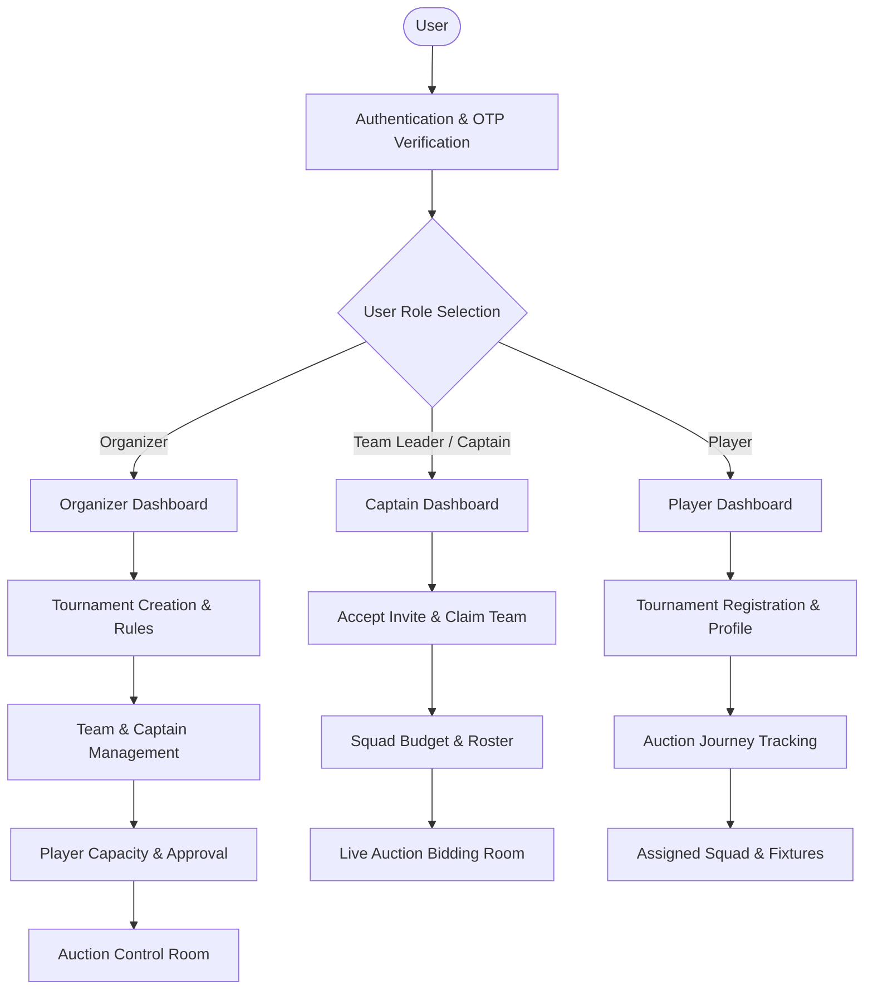
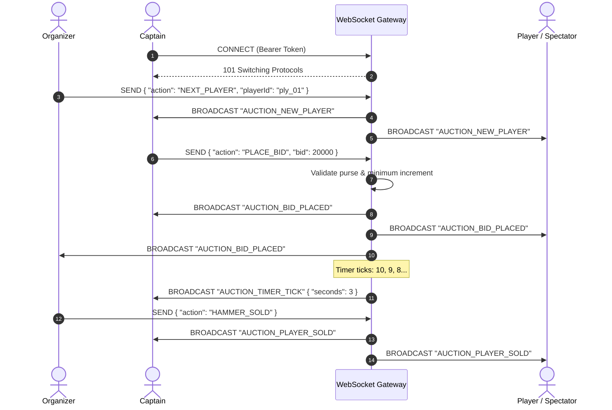

# CricAuction Backend API Specification & System Architecture

## 1. System Overview & Role Matrix

CricAuction is a mobile-first platform for cricket tournament management, live player auctions, and real-time scoring. The application serves three distinct user roles, each with dedicated dashboards, workflows, and permissions:



### Role Capabilities Summary
| Feature Module | Tournament Organizer | Team Leader (Captain) | Player |
| :--- | :---: | :---: | :---: |
| Account Registration & Auth | Full | Full | Full |
| Role Selection & Profile Setup | Full | Full | Full |
| Create & Configure Tournaments | Full (Owner) | View Only | View Only |
| Team & Captain Management | Full (Add/Edit/Invite) | Manage Own Team | View Teams |
| Player Registrations Management | Review, Approve, Price | View Squad | Register, Track |
| Live Auction Room | Controller (Hammer, Pass, Undo) | Active Bidder (Purse-checked) | Spectator |
| Matches & Scoring | Create & Score | View Fixtures | View Fixtures |

---

## 2. Global Conventions

- **Base URL**: `https://api.cricauction.app/api/v1`
- **WebSocket Gateway**: `wss://api.cricauction.app/ws/v1/auction`
- **Standard Authentication**: Bearer Token in `Authorization: Bearer <JWT_ACCESS_TOKEN>`
- **Content Types**: `application/json` (or `multipart/form-data` for file uploads)
- **Standard Response Envelope**:
```json
{
  "success": true,
  "message": "Action completed successfully",
  "data": {},
  "timestamp": "2026-10-24T14:00:00Z"
}
```
- **Standard Error Envelope**:
```json
{
  "success": false,
  "error": {
    "code": "VALIDATION_FAILED",
    "message": "Tournament end date must be on or after start date.",
    "details": [
      { "field": "endDate", "issue": "Must be >= startDate" }
    ]
  },
  "timestamp": "2026-10-24T14:00:00Z"
}
```

---

## 3. Module Breakdown & API Catalogue (62 Endpoints)

---

### Module 1: Authentication & Authorization (10 APIs)

#### 1. User Sign Up
- **Method**: `POST`
- **Endpoint**: `/auth/signup`
- **Access**: Public
- **Description**: Registers a new user account with full name, email, mobile, and password.
- **Request Payload**:
```json
{
  "fullName": "Hardik Patel",
  "email": "hardik@example.com",
  "mobile": "+919876543210",
  "password": "StrongPassword123!",
  "confirmPassword": "StrongPassword123!",
  "agreedToTerms": true
}
```
- **Response (201 Created)**:
```json
{
  "success": true,
  "message": "Account created. Please verify your mobile number.",
  "data": {
    "userId": "usr_948214",
    "mobile": "+919876543210",
    "email": "hardik@example.com",
    "isVerified": false,
    "otpExpirySeconds": 60
  }
}
```

#### 2. User Sign In (Login)
- **Method**: `POST`
- **Endpoint**: `/auth/signin`
- **Access**: Public
- **Description**: Authenticates user via email or mobile number with password.
- **Request Payload**:
```json
{
  "identifier": "hardik@example.com",
  "password": "StrongPassword123!",
  "rememberMe": true
}
```
- **Response (200 OK)**:
```json
{
  "success": true,
  "data": {
    "accessToken": "eyJhbGciOi...",
    "refreshToken": "eyJhbGciOi...",
    "expiresIn": 86400,
    "user": {
      "id": "usr_948214",
      "fullName": "Hardik Patel",
      "email": "hardik@example.com",
      "mobile": "+919876543210",
      "role": "organizer",
      "profilePhoto": "https://cdn.cricauction.app/avatars/usr_948214.jpg",
      "isVerified": true
    }
  }
}
```

#### 3. Send / Resend OTP
- **Method**: `POST`
- **Endpoint**: `/auth/otp/send`
- **Access**: Public
- **Description**: Dispatches a 6-digit OTP to mobile or email for verification or password recovery.
- **Request Payload**:
```json
{
  "mobile": "+919876543210",
  "purpose": "signup_verification"
}
```
- **Response (200 OK)**:
```json
{
  "success": true,
  "message": "OTP sent successfully to +91 98765 43210",
  "data": {
    "retryAfterSeconds": 45,
    "otpExpiresInSeconds": 300
  }
}
```

#### 4. Verify OTP
- **Method**: `POST`
- **Endpoint**: `/auth/otp/verify`
- **Access**: Public
- **Description**: Verifies the 6-digit OTP code submitted on the `/verify` screen.
- **Request Payload**:
```json
{
  "mobile": "+919876543210",
  "otp": "482910",
  "purpose": "signup_verification"
}
```
- **Response (200 OK)**:
```json
{
  "success": true,
  "message": "Verification successful",
  "data": {
    "isVerified": true,
    "resetToken": "rst_9812480124",
    "accessToken": "eyJhbGciOi..."
  }
}
```

#### 5. Forgot Password
- **Method**: `POST`
- **Endpoint**: `/auth/password/forgot`
- **Access**: Public
- **Description**: Triggers password reset OTP to registered email or mobile.
- **Request Payload**:
```json
{
  "identifier": "hardik@example.com"
}
```
- **Response (200 OK)**:
```json
{
  "success": true,
  "message": "Password reset OTP dispatched",
  "data": {
    "maskedContact": "+91 98765 *****",
    "deliveryMethod": "SMS"
  }
}
```

#### 6. Reset Password
- **Method**: `POST`
- **Endpoint**: `/auth/password/reset`
- **Access**: Public (Requires Reset Token from OTP verification)
- **Description**: Sets the new password after OTP verification.
- **Request Payload**:
```json
{
  "resetToken": "rst_9812480124",
  "newPassword": "NewStrongPassword456!",
  "confirmPassword": "NewStrongPassword456!"
}
```
- **Response (200 OK)**:
```json
{
  "success": true,
  "message": "Password updated successfully. Please log in."
}
```

#### 7. Refresh Access Token
- **Method**: `POST`
- **Endpoint**: `/auth/refresh-token`
- **Access**: Public
- **Request Payload**:
```json
{
  "refreshToken": "eyJhbGciOi..."
}
```
- **Response (200 OK)**:
```json
{
  "success": true,
  "data": {
    "accessToken": "eyJhbGciOi...",
    "expiresIn": 86400
  }
}
```

#### 8. User Logout
- **Method**: `POST`
- **Endpoint**: `/auth/logout`
- **Access**: Authenticated
- **Request Payload**:
```json
{
  "refreshToken": "eyJhbGciOi..."
}
```
- **Response (200 OK)**:
```json
{
  "success": true,
  "message": "Logged out successfully"
}
```

#### 9. Get Current User Profile
- **Method**: `GET`
- **Endpoint**: `/auth/me`
- **Access**: Authenticated
- **Response (200 OK)**:
```json
{
  "success": true,
  "data": {
    "id": "usr_948214",
    "fullName": "Hardik Patel",
    "email": "hardik@example.com",
    "mobile": "+919876543210",
    "role": "organizer",
    "city": "Surat",
    "profilePhoto": "https://cdn.cricauction.app/avatars/usr_948214.jpg",
    "isVerified": true
  }
}
```

#### 10. Switch / Set Active Role
- **Method**: `PATCH`
- **Endpoint**: `/auth/role`
- **Access**: Authenticated
- **Description**: Sets user role (`organizer`, `captain`, `player`) selected in `/role`.
- **Request Payload**:
```json
{
  "role": "organizer"
}
```
- **Response (200 OK)**:
```json
{
  "success": true,
  "message": "Role switched to organizer",
  "data": {
    "role": "organizer"
  }
}
```

---

### Module 2: Profile & Cricket Profile Management (4 APIs)

#### 11. Get User Profile Details
- **Method**: `GET`
- **Endpoint**: `/users/profile`
- **Access**: Authenticated
- **Response (200 OK)**:
```json
{
  "success": true,
  "data": {
    "fullName": "Hardik Patel",
    "email": "hardik@example.com",
    "mobile": "+919876543210",
    "city": "Surat, Gujarat",
    "profilePhoto": "https://cdn.cricauction.app/avatars/usr_948214.jpg",
    "role": "organizer",
    "bio": "Local cricket enthusiast and tournament manager."
  }
}
```

#### 12. Update User Profile
- **Method**: `PATCH`
- **Endpoint**: `/users/profile`
- **Access**: Authenticated
- **Request Payload**:
```json
{
  "fullName": "Hardik Patel",
  "mobile": "+919876543210",
  "city": "Surat, Gujarat"
}
```
- **Response (200 OK)**:
```json
{
  "success": true,
  "message": "Profile updated",
  "data": {
    "fullName": "Hardik Patel",
    "city": "Surat, Gujarat"
  }
}
```

#### 13. Upload Profile Photo
- **Method**: `POST`
- **Endpoint**: `/users/profile/photo`
- **Access**: Authenticated
- **Headers**: `Content-Type: multipart/form-data`
- **Form Data**: `photo: <binary file>`
- **Response (200 OK)**:
```json
{
  "success": true,
  "message": "Photo uploaded successfully",
  "data": {
    "profilePhotoUrl": "https://cdn.cricauction.app/avatars/usr_948214_v2.jpg"
  }
}
```

#### 14. Update Cricket Player Bio & Stats
- **Method**: `PUT`
- **Endpoint**: `/users/player-profile`
- **Access**: Authenticated (Player Role)
- **Request Payload**:
```json
{
  "playingRole": "All-Rounder",
  "battingStyle": "Right-hand bat",
  "bowlingStyle": "Right-arm medium fast",
  "jerseyNumber": 18,
  "cricHeroesProfileUrl": "https://cricheroes.in/player-profile/12345",
  "pastTournaments": 12,
  "highestScore": 94,
  "bestBowling": "4/18"
}
```
- **Response (200 OK)**:
```json
{
  "success": true,
  "message": "Player cricket profile updated",
  "data": { "updatedAt": "2026-10-24T14:00:00Z" }
}
```

---

### Module 3: Role-Specific Dashboards (3 APIs)

#### 15. Organizer Dashboard Feed
- **Method**: `GET`
- **Endpoint**: `/dashboard/organizer`
- **Access**: Organizer
- **Response (200 OK)**:
```json
{
  "success": true,
  "data": {
    "hasActiveDraft": true,
    "draftSummary": {
      "id": "tourn_spl_2026",
      "name": "Surat Premier League",
      "step": 3
    },
    "stats": {
      "myTournaments": 3,
      "teams": 10,
      "playersRegistered": 128,
      "upcomingAuctionDate": "28 Aug"
    },
    "upcomingTournament": {
      "id": "tourn_spl_2026",
      "name": "Surat Premier League",
      "status": "Registration Open",
      "teamsCount": 10,
      "playersCount": 128,
      "auctionDate": "2026-08-28T19:00:00Z",
      "auctionFormatted": "28 Aug • 7:00 PM"
    },
    "recentActivity": [
      {
        "id": "act_1",
        "type": "registration",
        "title": "128 players registered",
        "subtitle": "Surat Premier League",
        "timestamp": "2026-08-24T10:15:00Z"
      },
      {
        "id": "act_2",
        "type": "captain_joined",
        "title": "Captain joined your tournament",
        "subtitle": "Surat Strikers (Hardik Patel)",
        "timestamp": "2026-08-24T09:30:00Z"
      },
      {
        "id": "act_3",
        "type": "auction_scheduled",
        "title": "Auction scheduled for 28 Aug",
        "subtitle": "7:00 PM • Live auction room",
        "timestamp": "2026-08-23T18:00:00Z"
      }
    ]
  }
}
```

#### 16. Team Captain Dashboard Feed
- **Method**: `GET`
- **Endpoint**: `/dashboard/captain`
- **Access**: Captain
- **Response (200 OK)**:
```json
{
  "success": true,
  "data": {
    "team": {
      "id": "team_surat_strikers",
      "name": "Surat Strikers",
      "tournamentId": "tourn_spl_2026",
      "tournamentName": "Surat Premier League",
      "totalBudget": 1000000,
      "remainingBudget": 850000,
      "budgetFormatted": "₹8.5L",
      "squadSize": 11,
      "maxSquad": 15
    },
    "upcomingAuction": {
      "tournamentId": "tourn_spl_2026",
      "name": "Surat Premier League",
      "auctionDate": "2026-08-28T19:00:00Z",
      "displayDate": "28 Aug • 7:00 PM",
      "isLive": false
    },
    "upcomingMatch": {
      "id": "match_01",
      "opponent": "City Warriors",
      "schedule": "Sunday • 4:00 PM",
      "ground": "Lalbhai Contractor Stadium"
    }
  }
}
```

#### 17. Player Dashboard Feed
- **Method**: `GET`
- **Endpoint**: `/dashboard/player`
- **Access**: Player
- **Response (200 OK)**:
```json
{
  "success": true,
  "data": {
    "activeJourney": {
      "tournamentId": "tourn_spl_2026",
      "tournamentName": "Surat Premier League",
      "status": "Registered",
      "auctionAt": "28 Aug • 7:00 PM",
      "team": null,
      "basePrice": 5000
    },
    "myTournaments": [
      {
        "tournamentId": "tourn_spl_2026",
        "name": "Surat Premier League",
        "status": "Registered",
        "auctionDate": "28 Aug",
        "badge": "Active"
      },
      {
        "tournamentId": "tourn_dcc_2026",
        "name": "Diamond City Cup",
        "status": "Registration submitted",
        "badge": "Pending"
      }
    ],
    "upcomingMatches": []
  }
}
```

---

### Module 4: Tournament Management (Organizer) (8 APIs)

#### 18. Create Tournament Draft (Screen 16)
- **Method**: `POST`
- **Endpoint**: `/tournaments`
- **Access**: Organizer
- **Description**: Stores basic tournament details, location, venue, auction schedule, format, and dates.
- **Request Payload**:
```json
{
  "name": "Surat Premier League 2026",
  "location": "Surat, Gujarat",
  "ground": "Lalbhai Contractor Stadium",
  "startDate": "2026-09-05",
  "endDate": "2026-09-15",
  "auctionDate": "2026-08-28",
  "auctionTime": "19:00",
  "registrationStartDate": "2026-08-01",
  "registrationEndDate": "2026-08-25",
  "ballType": "Tennis",
  "format": "T20",
  "entryFee": "Free",
  "description": "Surat Premier League annual tournament and live auction."
}
```
- **Response (201 Created)**:
```json
{
  "success": true,
  "message": "Tournament draft created",
  "data": {
    "id": "tourn_spl_2026",
    "slug": "surat-premier-league-2026",
    "step": 1,
    "createdAt": "2026-10-24T14:00:00Z"
  }
}
```

#### 19. List Organizer Tournaments
- **Method**: `GET`
- **Endpoint**: `/tournaments`
- **Access**: Organizer
- **Query Params**: `status=draft|upcoming|ongoing|completed`
- **Response (200 OK)**:
```json
{
  "success": true,
  "data": [
    {
      "id": "tourn_spl_2026",
      "name": "Surat Premier League 2026",
      "location": "Surat, Gujarat",
      "startDate": "2026-09-05",
      "endDate": "2026-09-15",
      "teamsCount": 10,
      "playersRegistered": 128,
      "status": "upcoming"
    }
  ]
}
```

#### 20. Get Tournament Details by ID
- **Method**: `GET`
- **Endpoint**: `/tournaments/:id`
- **Access**: Authenticated
- **Response (200 OK)**:
```json
{
  "success": true,
  "data": {
    "id": "tourn_spl_2026",
    "name": "Surat Premier League 2026",
    "location": "Surat, Gujarat",
    "ground": "Lalbhai Contractor Stadium",
    "startDate": "2026-09-05",
    "endDate": "2026-09-15",
    "auctionDate": "2026-08-28",
    "auctionTime": "19:00",
    "auctionAt": "28 Aug • 7:00 PM",
    "ballType": "Tennis",
    "format": "T20",
    "entryFee": "Free",
    "settings": {
      "teams": 10,
      "squadMinimum": 12,
      "squadMaximum": 15,
      "budget": 1000000,
      "basePrice": 20000,
      "bidIncrement": 10000,
      "bidTimer": 10,
      "autoStartNext": false,
      "matches": 20,
      "matchDuration": 3
    }
  }
}
```

#### 21. Update Tournament Basic Details
- **Method**: `PATCH`
- **Endpoint**: `/tournaments/:id`
- **Access**: Organizer
- **Request Payload**: Same fields as creation (partial updates supported).
- **Response (200 OK)**:
```json
{
  "success": true,
  "message": "Tournament details updated"
}
```

#### 22. Save Tournament Rules & Settings (Screen 17)
- **Method**: `PUT`
- **Endpoint**: `/tournaments/:id/settings`
- **Access**: Organizer
- **Description**: Configures squad boundaries, auction purses, bid timer, auto-start, and match parameters.
- **Request Payload**:
```json
{
  "teams": 10,
  "squadMinimum": 12,
  "squadMaximum": 15,
  "budget": 1000000,
  "basePrice": 20000,
  "bidIncrement": 10000,
  "bidTimer": 10,
  "autoStartNext": false,
  "matches": 20,
  "matchDuration": 3,
  "allowPlayersToWithdraw": true
}
```
- **Response (200 OK)**:
```json
{
  "success": true,
  "message": "Tournament rules and auction settings saved",
  "data": {
    "step": 2,
    "teamsAllocated": 10
  }
}
```

#### 23. Publish / Launch Tournament
- **Method**: `POST`
- **Endpoint**: `/tournaments/:id/publish`
- **Access**: Organizer
- **Response (200 OK)**:
```json
{
  "success": true,
  "message": "Tournament is now live for registrations and invitations",
  "data": {
    "status": "published",
    "registrationLink": "https://cricauction.app/register/surat-premier-league-2026-spl26",
    "captainInviteLink": "https://cricauction.app/join/surat-premier-league-2026-ca10-28aug"
  }
}
```

#### 24. Delete / Archive Tournament
- **Method**: `DELETE`
- **Endpoint**: `/tournaments/:id`
- **Access**: Organizer
- **Response (200 OK)**:
```json
{
  "success": true,
  "message": "Tournament deleted successfully"
}
```

#### 25. Get Public Tournament Details (Share Link Lookup)
- **Method**: `GET`
- **Endpoint**: `/tournaments/public/:slug`
- **Access**: Public
- **Description**: Used by captain join link and player registration landing page.
- **Response (200 OK)**:
```json
{
  "success": true,
  "data": {
    "id": "tourn_spl_2026",
    "name": "Surat Premier League",
    "location": "Surat, Gujarat",
    "ground": "Lalbhai Contractor Stadium",
    "ballType": "Tennis",
    "format": "T20",
    "capacity": 150,
    "registered": 128,
    "registrationOpen": true,
    "auctionDate": "2026-08-28T19:00:00Z"
  }
}
```

---

### Module 5: Team & Captain Management (8 APIs)

#### 26. List Tournament Teams
- **Method**: `GET`
- **Endpoint**: `/tournaments/:id/teams`
- **Access**: Authenticated
- **Response (200 OK)**:
```json
{
  "success": true,
  "data": {
    "totalTeams": 10,
    "assignedCaptains": 4,
    "teams": [
      {
        "id": 1,
        "name": "Surat Strikers",
        "captainName": "Hardik Patel",
        "captainMobile": "+91 98765 43210",
        "status": "Accepted",
        "squadCount": 0
      },
      {
        "id": 5,
        "name": "Lions XI",
        "captainName": "Karan Mehta",
        "captainMobile": "+91 91234 56780",
        "status": "Invited",
        "squadCount": 0
      },
      {
        "id": 6,
        "name": "Rising Stars",
        "captainName": "",
        "captainMobile": "",
        "status": "Pending",
        "squadCount": 0
      }
    ]
  }
}
```

#### 27. Add New Team
- **Method**: `POST`
- **Endpoint**: `/tournaments/:id/teams`
- **Access**: Organizer
- **Request Payload**:
```json
{
  "name": "Coastal Riders",
  "captainName": "Vijay Varma",
  "captainMobile": "+91 98221 12233"
}
```
- **Response (201 Created)**:
```json
{
  "success": true,
  "message": "Team added",
  "data": {
    "id": 7,
    "name": "Coastal Riders",
    "status": "Pending"
  }
}
```

#### 28. Edit Team & Captain Assignment
- **Method**: `PATCH`
- **Endpoint**: `/tournaments/:id/teams/:teamId`
- **Access**: Organizer
- **Request Payload**:
```json
{
  "name": "Coastal Riders XI",
  "captainName": "Vijay Varma",
  "captainMobile": "+91 98221 12233"
}
```
- **Response (200 OK)**:
```json
{
  "success": true,
  "message": "Team details updated",
  "data": { "id": 7, "status": "Pending" }
}
```

#### 29. Delete Team
- **Method**: `DELETE`
- **Endpoint**: `/tournaments/:id/teams/:teamId`
- **Access**: Organizer
- **Response (200 OK)**:
```json
{
  "success": true,
  "message": "Team removed from tournament"
}
```

#### 30. Send Captain Invitation (WhatsApp / SMS)
- **Method**: `POST`
- **Endpoint**: `/tournaments/:id/teams/:teamId/invite`
- **Access**: Organizer
- **Description**: Triggers invite message and marks team status as `Invited`.
- **Request Payload**:
```json
{
  "channel": "whatsapp"
}
```
- **Response (200 OK)**:
```json
{
  "success": true,
  "message": "Invite dispatched",
  "data": {
    "teamId": 5,
    "status": "Invited",
    "inviteLink": "https://cricauction.app/join/spl26-team5"
  }
}
```

#### 31. Captain Accepts Invite
- **Method**: `POST`
- **Endpoint**: `/teams/join`
- **Access**: Authenticated (User claiming Captain role)
- **Request Payload**:
```json
{
  "inviteCode": "spl26-team5",
  "captainMobile": "+91 91234 56780"
}
```
- **Response (200 OK)**:
```json
{
  "success": true,
  "message": "You are now confirmed as Captain of Lions XI",
  "data": {
    "teamId": 5,
    "teamName": "Lions XI",
    "tournamentId": "tourn_spl_2026",
    "role": "captain"
  }
}
```

#### 32. Get Team Squad Roster & Purse
- **Method**: `GET`
- **Endpoint**: `/teams/:teamId/squad`
- **Access**: Authenticated
- **Response (200 OK)**:
```json
{
  "success": true,
  "data": {
    "teamId": 1,
    "teamName": "Surat Strikers",
    "totalPurse": 1000000,
    "spentPurse": 150000,
    "remainingPurse": 850000,
    "squadCount": 11,
    "maxSquad": 15,
    "players": [
      {
        "id": "ply_01",
        "name": "Rahul Patel",
        "role": "Batsman",
        "purchasePrice": 45000,
        "isCaptain": true
      }
    ]
  }
}
```

#### 33. Captain Updates Team Branding
- **Method**: `PATCH`
- **Endpoint**: `/teams/:teamId/profile`
- **Access**: Captain
- **Headers**: `Content-Type: multipart/form-data`
- **Form Data**: `logo: <binary file>, shortCode: "STR"`
- **Response (200 OK)**:
```json
{
  "success": true,
  "message": "Team profile updated"
}
```

---

### Module 6: Player Registration & Capacity Management (7 APIs)

#### 34. Player Registers for Tournament
- **Method**: `POST`
- **Endpoint**: `/tournaments/:id/players/register`
- **Access**: Authenticated (Player Role)
- **Request Payload**:
```json
{
  "playingRole": "Batsman",
  "battingStyle": "Right-hand bat",
  "bowlingStyle": "Right-arm off spin",
  "basePrice": 5000,
  "city": "Surat",
  "mobile": "+91 98989 89898",
  "jerseySize": "L",
  "cricHeroesLink": "https://cricheroes.in/player/9912"
}
```
- **Response (201 Created)**:
```json
{
  "success": true,
  "message": "Registration submitted successfully",
  "data": {
    "registrationId": "reg_81920",
    "status": "Registered",
    "tournamentName": "Surat Premier League"
  }
}
```

#### 35. Player Registration Status Tracking
- **Method**: `GET`
- **Endpoint**: `/tournaments/:id/players/my-status`
- **Access**: Player
- **Response (200 OK)**:
```json
{
  "success": true,
  "data": {
    "tournamentId": "tourn_spl_2026",
    "tournamentName": "Surat Premier League",
    "status": "Registered",
    "basePrice": 5000,
    "auctionSchedule": "2026-08-28T19:00:00Z",
    "soldToTeam": null,
    "soldPrice": null
  }
}
```

#### 36. Player Withdraws from Tournament
- **Method**: `DELETE`
- **Endpoint**: `/tournaments/:id/players/withdraw`
- **Access**: Player
- **Response (200 OK)**:
```json
{
  "success": true,
  "message": "You have successfully withdrawn from this tournament"
}
```

#### 37. Organizer Lists Registered Players
- **Method**: `GET`
- **Endpoint**: `/tournaments/:id/players`
- **Access**: Organizer
- **Query Params**: `filter=All|Registered|Pending|Batsman|Bowler|All-Rounder|Wicket Keeper&search=rahul&page=1&limit=20`
- **Response (200 OK)**:
```json
{
  "success": true,
  "data": {
    "total": 128,
    "page": 1,
    "limit": 20,
    "players": [
      {
        "id": 1,
        "name": "Rahul Patel",
        "role": "Batsman",
        "basePrice": "₹5,000",
        "status": "Registered",
        "mobile": "+91 98765 11111",
        "photo": "https://cdn.cricauction.app/players/1.jpg"
      },
      {
        "id": 2,
        "name": "Akash Shah",
        "role": "All-Rounder",
        "basePrice": "₹7,500",
        "status": "Registered",
        "mobile": "+91 98765 22222",
        "photo": "https://cdn.cricauction.app/players/2.jpg"
      },
      {
        "id": 3,
        "name": "Vivek Joshi",
        "role": "Bowler",
        "basePrice": "₹5,000",
        "status": "Pending",
        "mobile": "+91 98765 33333",
        "photo": null
      }
    ]
  }
}
```

#### 38. Player Registration Capacity Stats
- **Method**: `GET`
- **Endpoint**: `/tournaments/:id/players/stats`
- **Access**: Organizer
- **Response (200 OK)**:
```json
{
  "success": true,
  "data": {
    "capacity": 150,
    "registered": 128,
    "pending": 8,
    "approved": 120,
    "percentageFilled": 85,
    "isOpen": true,
    "roleBreakdown": {
      "batsmen": 45,
      "bowlers": 40,
      "allRounders": 30,
      "wicketKeepers": 13
    }
  }
}
```

#### 39. Organizer Approves / Rejects Player
- **Method**: `PATCH`
- **Endpoint**: `/tournaments/:id/players/:playerId/status`
- **Access**: Organizer
- **Request Payload**:
```json
{
  "status": "Registered",
  "reason": "Documents verified"
}
```
- **Response (200 OK)**:
```json
{
  "success": true,
  "message": "Player status updated"
}
```

#### 40. Organizer Sets / Updates Player Base Price
- **Method**: `PATCH`
- **Endpoint**: `/tournaments/:id/players/:playerId/base-price`
- **Access**: Organizer
- **Request Payload**:
```json
{
  "basePrice": 10000
}
```
- **Response (200 OK)**:
```json
{
  "success": true,
  "message": "Player base price updated"
}
```

---

### Module 7: Live Auction Engine (REST + WebSocket) (13 REST APIs + 8 Events)

#### 41. Initialize & Open Auction Room
- **Method**: `POST`
- **Endpoint**: `/tournaments/:id/auction/start`
- **Access**: Organizer
- **Response (200 OK)**:
```json
{
  "success": true,
  "message": "Auction room is now LIVE",
  "data": {
    "auctionId": "auc_9102",
    "status": "LIVE",
    "startedAt": "2026-08-28T19:00:00Z"
  }
}
```

#### 42. Pause Live Auction
- **Method**: `POST`
- **Endpoint**: `/tournaments/:id/auction/pause`
- **Access**: Organizer
- **Response (200 OK)**:
```json
{
  "success": true,
  "message": "Auction paused"
}
```

#### 43. Resume Live Auction
- **Method**: `POST`
- **Endpoint**: `/tournaments/:id/auction/resume`
- **Access**: Organizer
- **Response (200 OK)**:
```json
{
  "success": true,
  "message": "Auction resumed"
}
```

#### 44. Call Next Player to Hammer
- **Method**: `POST`
- **Endpoint**: `/tournaments/:id/auction/next-player`
- **Access**: Organizer
- **Request Payload**:
```json
{
  "playerId": "ply_01" // Optional: Omit for auto-queue
}
```
- **Response (200 OK)**:
```json
{
  "success": true,
  "data": {
    "player": {
      "id": "ply_01",
      "name": "Rahul Patel",
      "role": "Batsman",
      "battingStyle": "Right-hand",
      "basePrice": 5000,
      "photo": "https://cdn.cricauction.app/players/1.jpg"
    },
    "currentBid": 5000,
    "leadingTeam": null,
    "timerSeconds": 10
  }
}
```

#### 45. Place Bid (Captain)
- **Method**: `POST`
- **Endpoint**: `/tournaments/:id/auction/bid`
- **Access**: Captain
- **Request Payload**:
```json
{
  "bidAmount": 15000,
  "teamId": 1
}
```
- **Response (200 OK)**:
```json
{
  "success": true,
  "message": "Bid accepted",
  "data": {
    "currentBid": 15000,
    "leadingTeamId": 1,
    "leadingTeamName": "Surat Strikers",
    "timerReset": 10
  }
}
```

#### 46. Sell Player to Leading Team ("Sold")
- **Method**: `POST`
- **Endpoint**: `/tournaments/:id/auction/sell`
- **Access**: Organizer
- **Response (200 OK)**:
```json
{
  "success": true,
  "message": "Player SOLD",
  "data": {
    "playerId": "ply_01",
    "playerName": "Rahul Patel",
    "soldToTeamId": 1,
    "soldToTeamName": "Surat Strikers",
    "finalPrice": 45000,
    "remainingPurse": 805000
  }
}
```

#### 47. Pass Player as Unsold
- **Method**: `POST`
- **Endpoint**: `/tournaments/:id/auction/pass`
- **Access**: Organizer
- **Response (200 OK)**:
```json
{
  "success": true,
  "message": "Player marked UNSOLD",
  "data": {
    "playerId": "ply_03",
    "status": "UNSOLD"
  }
}
```

#### 48. Undo Last Bid
- **Method**: `POST`
- **Endpoint**: `/tournaments/:id/auction/undo`
- **Access**: Organizer
- **Response (200 OK)**:
```json
{
  "success": true,
  "message": "Last bid reverted",
  "data": {
    "currentBid": 35000,
    "leadingTeamId": 2,
    "leadingTeamName": "City Warriors"
  }
}
```

#### 49. Get Current Auction Room State (Full Snapshot)
- **Method**: `GET`
- **Endpoint**: `/tournaments/:id/auction/state`
- **Access**: Authenticated
- **Response (200 OK)**:
```json
{
  "success": true,
  "data": {
    "status": "LIVE",
    "currentPlayer": {
      "id": "ply_01",
      "name": "Rahul Patel",
      "role": "Batsman",
      "basePrice": 5000,
      "currentBid": 35000,
      "leadingTeam": "Surat Strikers",
      "secondsRemaining": 7
    },
    "teams": [
      {
        "id": 1,
        "name": "Surat Strikers",
        "remainingBudget": 850000,
        "squadCount": 11,
        "maxSquad": 15
      }
    ],
    "upcomingQueueCount": 24,
    "soldCount": 42,
    "unsoldCount": 6
  }
}
```

#### 50. Get Auction Transaction & Sold History
- **Method**: `GET`
- **Endpoint**: `/tournaments/:id/auction/history`
- **Access**: Authenticated
- **Response (200 OK)**:
```json
{
  "success": true,
  "data": [
    {
      "round": 1,
      "playerId": "ply_10",
      "playerName": "Hardik Shah",
      "role": "All-Rounder",
      "soldTo": "Surat Strikers",
      "price": 85000,
      "status": "SOLD"
    }
  ]
}
```

#### 51. Start Accelerated / Unsold Re-entry Round
- **Method**: `POST`
- **Endpoint**: `/tournaments/:id/auction/accelerated-round`
- **Access**: Organizer
- **Request Payload**:
```json
{
  "includeUnsold": true,
  "revisedBasePriceFactor": 0.8
}
```
- **Response (200 OK)**:
```json
{
  "success": true,
  "message": "Accelerated round prepared with 8 unsold players"
}
```

#### 52. Captain Views Target Player Wishlist
- **Method**: `GET`
- **Endpoint**: `/tournaments/:id/auction/wishlist`
- **Access**: Captain
- **Response (200 OK)**:
```json
{
  "success": true,
  "data": [
    { "playerId": "ply_04", "priority": "High", "maxBudget": 75000 }
  ]
}
```

#### 53. Captain Adds / Removes Player from Wishlist
- **Method**: `POST`
- **Endpoint**: `/tournaments/:id/auction/wishlist`
- **Access**: Captain
- **Request Payload**:
```json
{
  "playerId": "ply_04",
  "action": "add",
  "maxBudget": 75000
}
```
- **Response (200 OK)**:
```json
{
  "success": true,
  "message": "Wishlist updated"
}
```

---

### Real-Time WebSocket Events Specification

Connected via: `wss://api.cricauction.app/ws/v1/auction?token=<JWT>&tournamentId=<ID>`



| Event Name | Direction | Payload Key Fields |
| :--- | :--- | :--- |
| `AUCTION_ROOM_STATE` | Server -> Client | Full snapshot upon joining |
| `AUCTION_NEW_PLAYER` | Server -> Client | `playerId`, `name`, `role`, `basePrice`, `timer` |
| `AUCTION_BID_PLACED` | Server -> Client | `bidAmount`, `teamId`, `teamName`, `nextAllowedBid` |
| `AUCTION_TIMER_TICK` | Server -> Client | `secondsRemaining`, `status` |
| `AUCTION_GOING_TWICE` | Server -> Client | `warningLevel` (1 = Going Once, 2 = Going Twice) |
| `AUCTION_PLAYER_SOLD` | Server -> Client | `playerId`, `teamId`, `amount`, `newTeamPurse` |
| `AUCTION_PLAYER_UNSOLD`| Server -> Client | `playerId`, `status: UNSOLD` |
| `AUCTION_PAUSED_RESUMED`| Server -> Client | `status: PAUSED | LIVE` |

---

### Module 8: Matches, Fixtures & Scoring (5 APIs)

#### 54. List Tournament Fixtures
- **Method**: `GET`
- **Endpoint**: `/tournaments/:id/matches`
- **Access**: Authenticated
- **Response (200 OK)**:
```json
{
  "success": true,
  "data": [
    {
      "id": "match_01",
      "team1": "Surat Strikers",
      "team2": "City Warriors",
      "scheduledAt": "2026-09-06T16:00:00Z",
      "ground": "Lalbhai Contractor Stadium",
      "status": "UPCOMING"
    }
  ]
}
```

#### 55. Create Match Fixture
- **Method**: `POST`
- **Endpoint**: `/tournaments/:id/matches`
- **Access**: Organizer
- **Request Payload**:
```json
{
  "team1Id": 1,
  "team2Id": 2,
  "scheduledAt": "2026-09-06T16:00:00Z",
  "ground": "Lalbhai Contractor Stadium",
  "overs": 20
}
```
- **Response (201 Created)**:
```json
{
  "success": true,
  "message": "Fixture scheduled"
}
```

#### 56. Get Match Scorecard
- **Method**: `GET`
- **Endpoint**: `/matches/:matchId`
- **Access**: Authenticated
- **Response (200 OK)**:
```json
{
  "success": true,
  "data": {
    "matchId": "match_01",
    "team1": { "name": "Surat Strikers", "runs": 164, "wickets": 4, "overs": 20 },
    "team2": { "name": "City Warriors", "runs": 120, "wickets": 7, "overs": 16.2 },
    "currentBatsmen": [{ "name": "Rahul Patel", "runs": 48, "balls": 29 }],
    "currentBowler": { "name": "Vivek Joshi", "overs": 3.2, "wickets": 2 }
  }
}
```

#### 57. Live Match Ball-by-Ball Update
- **Method**: `PATCH`
- **Endpoint**: `/matches/:matchId/score`
- **Access**: Organizer (Scorer)
- **Request Payload**:
```json
{
  "over": 16,
  "ball": 3,
  "runs": 4,
  "isWicket": false,
  "batsmanId": "ply_01",
  "bowlerId": "ply_03"
}
```
- **Response (200 OK)**:
```json
{
  "success": true,
  "message": "Ball recorded"
}
```

#### 58. Get Tournament Standings (Points Table)
- **Method**: `GET`
- **Endpoint**: `/tournaments/:id/standings`
- **Access**: Authenticated
- **Response (200 OK)**:
```json
{
  "success": true,
  "data": [
    {
      "rank": 1,
      "team": "Surat Strikers",
      "played": 3,
      "won": 3,
      "lost": 0,
      "nrr": "+1.420",
      "points": 6
    }
  ]
}
```

---

### Module 9: Notifications & Alerts (4 APIs)

#### 59. List Notifications
- **Method**: `GET`
- **Endpoint**: `/notifications`
- **Access**: Authenticated
- **Response (200 OK)**:
```json
{
  "success": true,
  "data": [
    {
      "id": "notif_01",
      "title": "Auction Starting Soon",
      "body": "Surat Premier League auction starts in 1 hour.",
      "read": false,
      "createdAt": "2026-08-28T18:00:00Z"
    }
  ]
}
```

#### 60. Mark Notification as Read
- **Method**: `PATCH`
- **Endpoint**: `/notifications/:id/read`
- **Access**: Authenticated
- **Response (200 OK)**:
```json
{ "success": true }
```

#### 61. Mark All Notifications as Read
- **Method**: `POST`
- **Endpoint**: `/notifications/read-all`
- **Access**: Authenticated
- **Response (200 OK)**:
```json
{ "success": true }
```

#### 62. Register Device Push Token (FCM / APNS)
- **Method**: `POST`
- **Endpoint**: `/notifications/device-token`
- **Access**: Authenticated
- **Request Payload**:
```json
{
  "deviceToken": "fcm_token_string_here",
  "platform": "ios"
}
```
- **Response (200 OK)**:
```json
{ "success": true }
```

---

## 4. Summary Matrix: API Count by Module & Role

| Module No. | Module Name | Number of Endpoints | Primary Target Role |
| :---: | :--- | :---: | :--- |
| **1** | Authentication & OTP Verification | **10** | Public & All Roles |
| **2** | User Profile & Cricket Bio | **4** | All Roles / Players |
| **3** | Role Dashboards Feed | **3** | Organizer, Captain, Player |
| **4** | Tournament Creation & Rules | **8** | Tournament Organizer |
| **5** | Teams & Captain Management | **8** | Organizer & Team Captain |
| **6** | Player Registrations & Capacity | **7** | Organizer & Player |
| **7** | Live Auction Engine (REST) | **13** | Organizer & Captain |
| **8** | Fixtures, Scoring & Standings | **5** | Organizer, Captain, Player |
| **9** | Notifications & Push Messaging | **4** | All Roles |
| **Total** | **Full System REST Endpoints** | **62 APIs** | *(+ 8 WebSocket Events)* |
